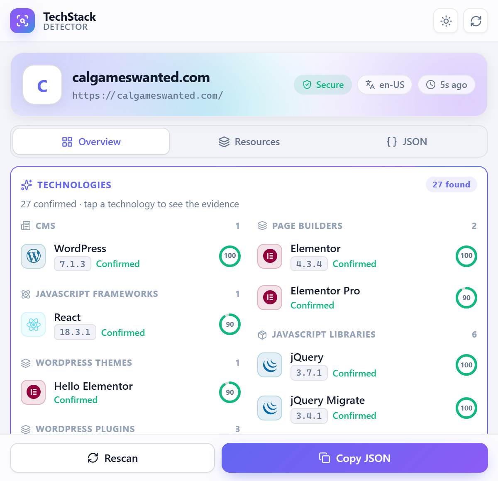
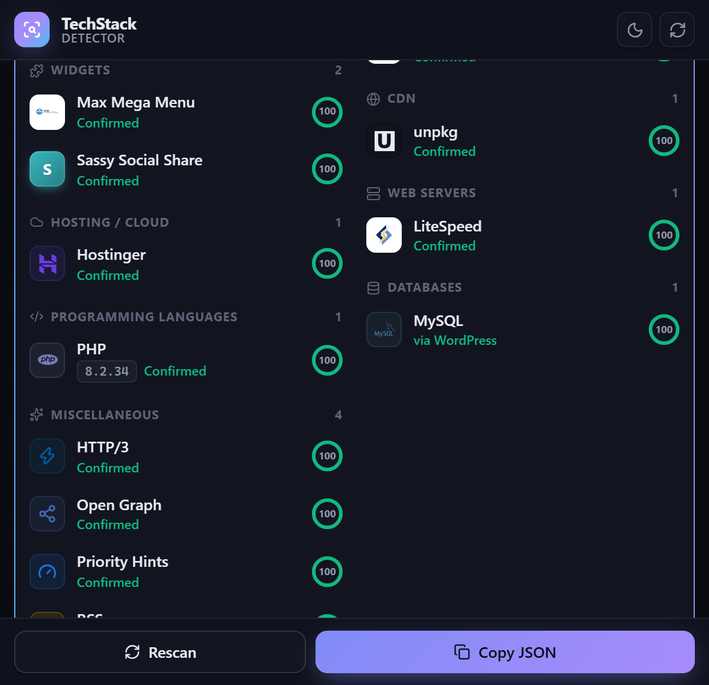
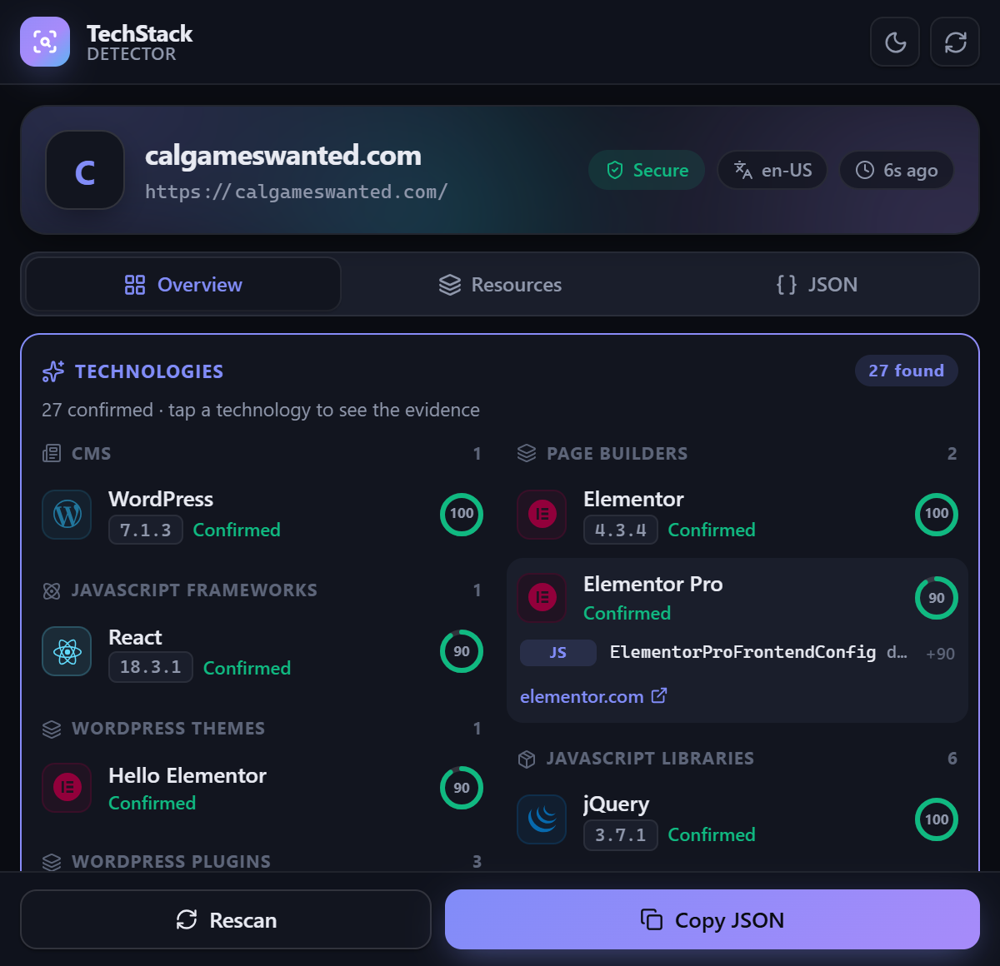
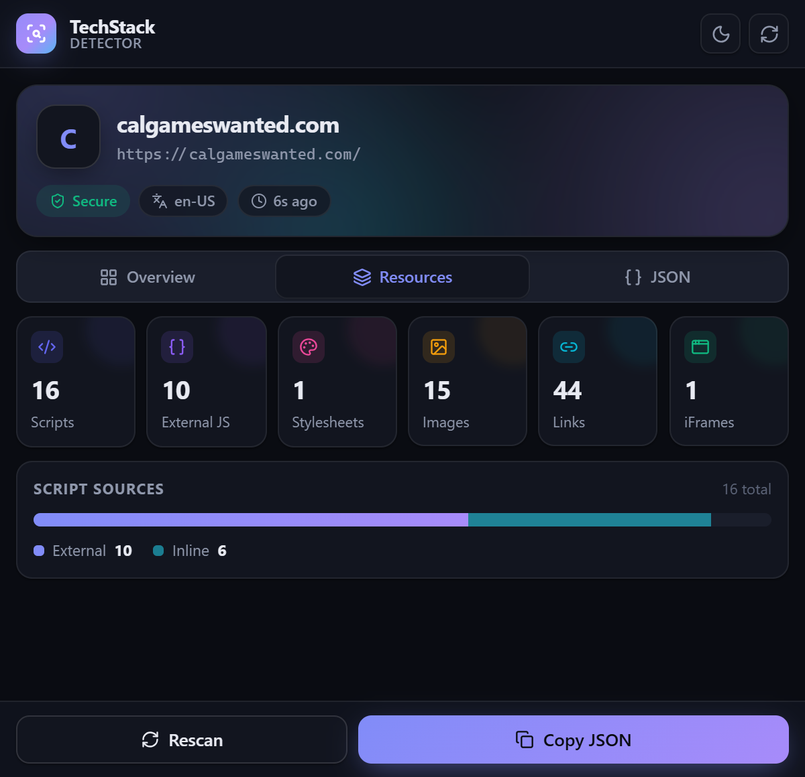

<div align="center">


# 🔎 TechStack Detector

**A Wappalyzer-style Chrome extension that identifies the technologies behind any website: CMS, frameworks, libraries, analytics, CDN, hosting, servers and more, with confidence scores, versions and evidence.**


</div>

---

## 📑 Table of contents

1. [✨ Features](#-features)
2. [📸 Screenshots](#-screenshots)
3. [🚀 Quick start](#-quick-start)
4. [🧭 Using the extension](#-using-the-extension)
5. [🏗️ Architecture](#️-architecture)
6. [🧠 How detection works](#-how-detection-works)
7. [📊 Confidence, versions & evidence](#-confidence-versions--evidence)
8. [📚 Rules & categories](#-rules--categories)
9. [📦 Optional GPL Wappalyzer pack](#-optional-gpl-wappalyzer-pack)
10. [🎨 Icons & logos](#-icons--logos)
11. [🔐 Permissions & privacy](#-permissions--privacy)
12. [🧪 Testing](#-testing)
13. [🛠️ Scripts reference](#️-scripts-reference)
14. [📁 Project structure](#-project-structure)
15. [➕ Adding a technology](#-adding-a-technology)
16. [🩺 Troubleshooting](#-troubleshooting)
17. [🗺️ Roadmap](#️-roadmap)
18. [📄 License](#-license)

---

## ✨ Features

| | Feature | Details |
| --- | --- | --- |
| 🔍 | **7,500+ technologies** | About 260 hand-written, tested rules, plus an optional pack of about 7,260 from the open Wappalyzer database |
| 🎯 | **Confidence scoring** | Every detection is *Confirmed*, *Likely* or *Possible*, based on how strong and how many its signals are |
| 🔢 | **Version detection** | Reported only when a reliable fingerprint gives one (e.g. *WordPress 7.1.3*, *React 18.3.1*, *PHP 8.2.34*) |
| 🧾 | **Evidence** | Tap any technology to see exactly which signals matched and how much each contributed |
| 🗂️ | **33 categories** | CMS, page builders, frameworks, libraries, analytics, CDN, hosting, security and more, shown in a two-column layout |
| 🌐 | **11 signal sources** | HTML, DOM, JS globals, script and link URLs, CSS text, HTTP headers, cookies (including HttpOnly), XHR/fetch calls, visible text and meta tags |
| ⏱️ | **Delayed-script aware** | Finds scripts that LiteSpeed, WP Rocket and similar plugins hide until the user interacts |
| 🔁 | **Auto rescans** | After the first interaction, about 4 s after load, and on single-page-app route changes |
| 🏷️ | **Toolbar badge** | Shows the number of technologies found on the current tab |
| 🖼️ | **Real logos** | About 97% of technologies show a brand icon, bundled offline |
| 🌗 | **Light / dark / system** themes | Remembered between sessions |
| ✨ | **Animated UI** | Built with Motion; respects *reduce motion* |
| 📋 | **Copy JSON** | Export the full scan, including evidence |

---

## 📸 Screenshots

| Light theme | Dark theme |
| --- | --- |
|  |  |

| Evidence for a detection | Resources tab |
| --- | --- |
|  |  |

---

## 🚀 Quick start

### ✅ Requirements

- **Node.js 22+** (developed on Node 24)
- **Google Chrome 116+**, or another Chromium browser such as Edge or Brave
- **Microsoft Edge or Chromium**: only needed for `npm run pack:fetch` (to shrink oversized icons) and for `npm run test:e2e`

### 📥 Install and build

```bash
cd extension
npm install
npm run pack:fetch     # first time only: download Wappalyzer data and icons (~80 MB)
npm run build          # → dist/
```

> 💡 `pack:fetch` is only needed once, and again whenever you want fresh Wappalyzer data. If you don't want the GPL pack at all, skip it and run `npm run build:core` instead.

### 🧩 Load into Chrome

1. Open **`chrome://extensions`**.
2. Turn on **Developer mode** (top right).
3. Click **Load unpacked** and select the **`extension/dist`** folder.
4. Pin the extension (puzzle icon → 📌).

### 🔄 After every rebuild

1. Click **↻** on the TechStack Detector card in `chrome://extensions`. Chrome keeps running the old code until you do.
2. **Reload the website tab.** Header-based detections (servers, CDNs, security policies) only work for pages loaded *after* the extension.
3. Check the popup header: it shows **"Detector · v1.5.4"**.

---

## 🧭 Using the extension

### 🖱️ The popup

| Area | What it shows |
| --- | --- |
| **Header** | Logo, version, theme toggle (☀️ / 🌙 / 🖥️), rescan button |
| **Site card** | Favicon, hostname, URL, chips for *Secure* or *Not secure*, language and scan time |
| **Overview tab** | 🧩 **Technologies**, grouped by category in two columns, then 📄 **Page details** (title, description, generator, language, charset, URL); click a detail to copy it |
| **Resources tab** | Counts of scripts, external scripts, stylesheets, images, links and iFrames, plus an external-vs-inline script bar |
| **JSON tab** | The full scan result with syntax highlighting |
| **Footer** | 🔄 **Rescan** and 📋 **Copy JSON** |

### 🧾 Reading a technology row

```
[logo]  WordPress            ⭕ 100
        7.1.3  Confirmed
```

- **Version chip:** appears only when a fingerprint reliably exposed a version.
- **Level:** 🟢 *Confirmed*, 🔵 *Likely*, 🟠 *Possible*, or *via X* when the technology was implied by another (e.g. *PHP via WordPress*).
- **Ring:** the confidence score (0–100).
- **Click the row** to expand its evidence: each signal type (`META`, `HTML`, `SCRIPT`, `HEADER`, `JS`, `COOKIE`, `CSS`…), the matched value and its weight (`+100`).

### ⚠️ "Response headers weren't captured"

This banner appears when the tab was loaded **before** the extension started or was reloaded. Headers are only recorded while a page loads, so **reload the tab** to detect web servers, CDNs and the services listed in the site's Content-Security-Policy.

---

## 🏗️ Architecture

```
                   ┌──────────────── Website tab ────────────────┐
                   │  content.js (isolated world)                │
                   │   • HTML, inline + decoded data: scripts    │
                   │   • script/link URLs, meta, cookies, CSS    │
                   │   • DOM probes, CSS variables, visible text │
                   │  probeMainWorld() (page's MAIN world)       │
                   │   • JS globals (window.React, Shopify…)     │
                   │   • DOM expandos (__reactFiber$, __k…)      │
                   └───────────────┬─────────────────────────────┘
                                   │ COLLECT_FINGERPRINT
 ┌──────────┐   SCAN_TAB   ┌───────▼───────────────────────────────┐
 │  Popup   │ ───────────▶ │  Service worker (background.js)       │
 │ (React)  │ ◀─────────── │   • webRequest: headers + requests    │
 └──────────┘   result     │   • chrome.cookies: HttpOnly names    │
                           │   • detector.detect(fingerprint)      │
                           │   • tab cache + toolbar badge         │
                           └───────────────────────────────────────┘
```

### 🧩 The pieces

| Part | File | Role |
| --- | --- | --- |
| ⚙️ **Service worker** | `src/background/serviceWorker.js` | The hub. Captures headers and network requests, runs scans, caches results per tab, updates the badge, routes messages. |
| 📄 **Content script** | `src/content/content.js` | Runs in each page. Collects the fingerprint on request and triggers automatic rescans. |
| 🧠 **Main-world probe** | `src/detector/scanners/jsScanner.js` | Injected into the page's own JavaScript context. Reads globals and DOM properties the content script can't see. |
| ⚛️ **Popup** | `src/popup/`, `src/components/` | React 19 UI with Motion animations. |
| 🔬 **Detector** | `src/detector/` | Pure JavaScript (no Chrome APIs), so it's fully unit-testable. |

### 💬 Messages

All messages are defined in `src/shared/messages.js`, and every response has the shape `{ ok: true, data } | { ok: false, error }`.

| Message | From → To | Purpose |
| --- | --- | --- |
| `PAGE_READY` | content → SW | Page loaded or interacted with, or the route changed. Run an auto-scan. |
| `COLLECT_FINGERPRINT` | SW → content | Collect raw evidence for a scan |
| `SCAN_TAB` | popup → SW | Full scan of the active tab |
| `GET_TAB_DATA` | popup → SW | Cached result, for an instant render |

### 🔁 When scans happen

1. **Page load** (`document_idle`).
2. **About 4 s later**: apps often render late (loading screens, client-side redirects, chat widgets).
3. **2.5 s after the first scroll, click or keypress**, to catch scripts that optimisers delay until interaction.
4. **On single-page-app navigation** (Navigation API, debounced).
5. **Whenever the popup opens**, or you press **Rescan**.

Concurrent scans of the same tab are merged into one.

---

## 🧠 How detection works

Detection works in four steps: **collect evidence → match rules → score → resolve relationships.**

### 1️⃣ Collect evidence (the fingerprint)

| Signal type | Source | Example |
| --- | --- | --- |
| `html` | Page HTML, plus inline scripts that WP Rocket stores as base64 | `/wp-content/plugins/` |
| `text` | Visible page text (`innerText`) | `Powered by …` |
| `scripts` | Contents of inline `<script>` tags | `_paq.push(` |
| `scriptSrc` | `<script src>`, delayed `data-src` scripts and network requests | `cdn.shopify.com` |
| `links` | `<link href>`, stylesheets and fonts | `fonts.googleapis.com` |
| `css` | Text of same-origin stylesheets, including CSS merged by optimisers | `font-family: "Font Awesome 5 Free"` |
| `meta` | `<meta name/property>` | `generator: WordPress 7.1.3` |
| `headers` | HTTP response headers (`webRequest`) | `server: cloudflare`, `x-powered-by: PHP/8.2` |
| `cookies` | Cookie **names** only, including HttpOnly | `laravel_session`, `_shopify_y` |
| `xhr` | fetch/XHR/beacon request URLs | `ip-api.com/json` |
| `js` | Page globals (main world) | `React.version`, `jQuery.fn.jquery` |
| `jsPrefix` | Globals with generated names | `webpackChunk_N_E`, `__sveltekit_x1y2` |
| `dom` | CSS selectors, attributes and element text | `[ng-version]`, `astro-island` |
| `expando` | JS properties on DOM nodes | `__reactFiber$`, `__vue_app__` |
| `cssVars` | Computed CSS custom properties | `--tw-ring-offset-width` (Tailwind) |
| `url` | Page URL | `/wp-admin/` |

> 🛡️ **Why three collection contexts?** Content scripts run in an *isolated world* and can't see `window.React` or React's DOM markers. Only the main-world probe can. HTTP headers aren't visible to page scripts at all, so the service worker reads them via `webRequest`. HttpOnly cookies aren't in `document.cookie`, so their names come from `chrome.cookies`.

### 2️⃣ Match rules

Each technology is a declarative rule, and the engine has no technology-specific code. A rule looks like this:

```js
{
  name: "Shopify",
  category: "ecommerce",
  website: "https://www.shopify.com",
  color: "#95bf47",
  headers: { "x-shopid": true },                       // header exists
  scriptSrc: [/cdn\.shopify\.com/i],                    // URL pattern
  cookies: { _shopify_y: true },                        // cookie name
  js: { "Shopify.shop": { weight: 90 } },               // page global
  meta: { generator: { pattern: /^Shopify/, version: "\\1" } }
}
```

### 3️⃣ Score

Each matching signal adds its **weight**, and the total is capped at 100. Strong, hard-to-fake signals weigh more than loose text matches:

| Signal | Default weight |
| --- | --- |
| `meta`, `headers` | 100 |
| `expando` | 90 |
| `js`, `xhr`, `cssVars`, `jsPrefix` | 80 |
| `dom` | 70 |
| `scriptSrc`, `links`, `cookies`, `css` | 60 |
| `scripts` | 50 |
| `html`, `text`, `url` | 40 |

### 4️⃣ Resolve relationships

| Relationship | Example | Effect |
| --- | --- | --- |
| `implies` | Next.js → React; WordPress → PHP, MySQL | Adds the implied technology, shown as *via Next.js* |
| `excludes` | Lodash excludes Underscore.js | Removes a look-alike |
| `requires` | *a3 Lazy Load* requires WordPress | Dropped unless the required technology is present |
| `requiresCategory` | *Afterpay* requires an ecommerce platform | Dropped unless something in that category is detected |
| `versionOnly` | `_.VERSION` for Lodash | Supplies a version but can never detect on its own |

---

## 📊 Confidence, versions & evidence

| Level | Score | Meaning |
| --- | --- | --- |
| 🟢 **Confirmed** | ≥ 80 | One very strong signal, or several medium ones |
| 🔵 **Likely** | 50–79 | Good evidence, not conclusive |
| 🟠 **Possible** | < 50 | A single weak signal; treat as a hint |

**Versions** come from regex capture groups (`version: "\\1"`), including ternary templates like `\1?GA4:UA`. When several signals report a version, the most specific wins (`18.3.1` beats `18`). A version is never guessed: no reliable pattern means no version.

**Evidence** records the signal type, the key (e.g. the header name), the matched value (truncated) and its weight. **Cookie values are never shown or stored**; only the fact that a cookie exists.

---

## 📚 Rules & categories

There are **258 hand-written rules** in **33 categories**, one file per area in `src/detector/rules/`:

| File | Covers |
| --- | --- |
| 📝 `cms.js` | WordPress, Drupal, Joomla, Ghost, Webflow, Wix, Squarespace, Framer, Duda, HubSpot CMS, TYPO3, Blogger, Contentful, Sanity, Strapi |
| 🧱 `wordpress.js` | Page builders (Elementor, Divi, WPBakery, Bricks…), themes (Astra, Kadence, Hello Elementor…), plugins (Yoast, Rank Math, WP Rocket, LiteSpeed Cache, Contact Form 7…) |
| 🛒 `ecommerce.js`, 💳 `payments.js` | Shopify, WooCommerce, Magento, BigCommerce, PrestaShop, Stripe, PayPal, Razorpay, Paddle, Klarna… |
| ⚛️ `frameworks.js` | React, Next.js, Vue, Nuxt, Angular, Svelte, SvelteKit, Astro, Gatsby, Remix, Ember, Preact, SolidJS, Qwik, Lit, Meteor… |
| 📦 `libraries.js` | jQuery (+ UI, Migrate), Lodash, Underscore, GSAP, Swiper, Slick, Lottie, Chart.js, Three.js, D3, PDF.js, htmx… |
| 🎨 `ui.js` | Tailwind, Bootstrap, Bulma, Foundation, MUI, Ant Design, Chakra, Mantine, Radix, DaisyUI, Lucide, Font Awesome, Google Fonts… |
| 📈 `analytics.js` | Google Analytics, GTM, Hotjar, Mixpanel, PostHog, Meta Pixel, Clarity, Amplitude, Matomo, Segment, Pendo, Vercel Analytics… |
| 🎬 `media.js`, 🧰 `widgets.js` | YouTube, Vimeo; live chat (Intercom, Crisp, Zoho SalesIQ…), cookie banners, maps, ads, email marketing |
| 🛡️ `security.js` | Cloudflare Turnstile, hCaptcha, reCAPTCHA, Sentry, Datadog |
| 🌐 `cdn.js`, ☁️ `hosting.js`, 🖥️ `servers.js` | Cloudflare, CloudFront, Fastly, Akamai; Vercel, Netlify, AWS, GCP, Azure, Hostinger, Kinsta; Nginx, Apache, LiteSpeed… |
| 🧑‍💻 `languages.js` | Laravel, Django, Rails, Express, ASP.NET, PHP, Java, Node.js… |
| ✨ `misc.js` | Open Graph, RSS, HTTP/3, HSTS, PWA, Priority Hints, webpack, Vite, Turbopack, MySQL… |

Every one of these rules has a **test fixture** that proves it fires. The test suite fails if a rule is added without one.

---

## 📦 Optional GPL Wappalyzer pack

For Wappalyzer-level coverage, the default build includes **about 7,260 more technologies** converted from the community-maintained Wappalyzer database, [enthec/webappanalyzer](https://github.com/enthec/webappanalyzer).

> ⚖️ **Licence:** that data is **GPL-3.0**. A build that includes the pack must be distributed under GPL-3.0 terms, which means making the full source available. Use **`npm run build:core`** for a build with **only our own rules and no GPL code**: a 67 KB service worker instead of about 1.8 MB.

| Step | Command | What happens |
| --- | --- | --- |
| 1 | `npm run pack:fetch` | Downloads fingerprints, categories, icons and the LICENSE into `vendor/webappanalyzer/`. Oversized icons are rendered to 64 px PNGs. |
| 2 | `npm run build` | Converts the data into `src/detector/packs/wappalyzer.generated.js`, then builds |

**How the conversion works** (`scripts/lib/convertWappalyzer.mjs`):

- 🔄 **Fields are mapped** onto our signal types (`text`, `scripts`, `dom` attributes and text, `properties` → `expando`, and so on).
- 🧮 **Modifiers are honoured:** `\;version:\1` and `\;confidence:N`; `confidence:0` becomes version-only.
- 🤝 **Our own rule wins** where both define a technology. Upstream signals our rule lacks are **merged in** as a *supplement*, in pack builds only.
- 🏷️ **Name aliases**, e.g. *Google Font API* → *Google Fonts*, so there are no duplicates.
- 🚫 **Server-side-only fingerprints are skipped** (DNS, robots.txt, certificates).
- 🩹 **`PACK_PATCHES`** fixes upstream fingerprints that misfired on real sites (e.g. Onsen UI matching `consent.min.js`, PyScript keyed on a Marketo cookie).
- 💾 **The pack file is written atomically**, so an interrupted import can't break the next build.

---

## 🎨 Icons & logos

Icons are chosen in this order:

1. 🏷️ **[Simple Icons](https://simpleicons.org)** brand logo (CC0). Only the icons actually used are bundled, in `src/components/techIcons.generated.js`.
2. ⚡ **Symbols for web standards**: HTTP/3 ⚡, Open Graph 🔗, Priority Hints, HSTS 🔒, PWA 📱.
3. 🖼️ **The upstream icon from the GPL pack**, copied into `dist/tech-icons/`. Shown with ``, so scripts inside an SVG can never run.
4. 🔤 **A coloured letter tile** as the last resort, with a colour derived from the name.

The result is a real icon for about **97%** of technologies. Near-black logos (Next.js, Vercel, X) switch to the text colour in dark mode.

---

## 🔐 Permissions & privacy

| Permission | Why it's needed |
| --- | --- |
| `host_permissions` (http/https) | Scan any site automatically and run the main-world probe |
| `scripting` | Inject the content script into tabs opened before install, and run the main-world probe |
| `webRequest` | Read HTTP response headers and the page's own network requests |
| `cookies` | Read the **names** of HttpOnly cookies (e.g. `laravel_session`) |
| `storage` | Per-tab scan cache (session) and the last scan |
| `activeTab` | Scan the current tab when you open the popup |

🔒 **Privacy:**

- **All detection runs locally.** Nothing is sent to any server, and there's no analytics or tracking.
- **Cookie values are never read into results**, only their names.
- **Results live in `chrome.storage.session`**: they're cleared when the browser closes, and per tab on navigation or close.
- **Requests made inside third-party iframes are ignored**, so embedded widgets don't pollute a site's stack.

---

## 🧪 Testing

```bash
npm test            # 351 unit, coverage, regression and pack tests (~3 s)
npm run test:e2e    # real browser: 26 live websites in headless Edge (~5 min)
```

| Suite | File | What it checks |
| --- | --- | --- |
| 🧠 Engine | `tests/detector.test.js` | Matching, scoring, implies, versions, false positives |
| 🧩 Coverage | `tests/technologies.test.js` | **Every rule fires on its fixture**, extracts the right version, and never reports a version it can't support; plus false-positive look-alikes |
| 🔁 Regression | `tests/regression.test.js` | Restricted URLs, message contract, the probe surviving Chrome's serialisation, every category having an icon |
| 📦 Pack | `tests/pack.test.js` | Converter rules, supplements, CSP-based detection, no duplicates, nothing detected on a plain page |
| 🌐 End-to-end | `scripts/e2e.mjs` | Loads `dist/` as a real extension, opens 26 live sites (Wappalyzer-compared), simulates a user interaction and checks the expected technologies |

```bash
npm run test:e2e -- calgameswanted             # one site
E2E_DUMP=./dumps npm run test:e2e -- webvoltz  # save full scan JSON for debugging
```

> ℹ️ Google Chrome 137+ ignores `--load-extension`, so the e2e suite uses **Edge** or **Chromium**. Set `BROWSER=<path>` to choose one.

---

## 🛠️ Scripts reference

| Command | Description |
| --- | --- |
| `npm run build` | Import the pack (if fetched), generate icons, build into `dist/` |
| `npm run build:core` | Build with **our rules only** (no GPL data or icons) |
| `npm run dev` | Rebuild on every save (then click ↻ in Chrome) |
| `npm test` | Unit, coverage and regression tests |
| `npm run test:e2e` | Real-browser test against live sites |
| `npm run pack:fetch` | Download or refresh the Wappalyzer data and icons |
| `npm run pack:import` | Re-convert the pack without a full build |
| `npm run icons:tech` | Regenerate Simple Icons logos (verbose report) |
| `npm run icons` | Regenerate the extension's own toolbar icons |

---

## 📁 Project structure

```
extension/
├── 📄 public/
│   ├── manifest.json                 Manifest V3
│   └── icons/                        toolbar icons (generated)
├── 🛠️ scripts/
│   ├── build.mjs                     build pipeline (pages → content IIFE)
│   ├── e2e.mjs                       real-browser test
│   ├── fetch-wappalyzer.mjs          download pack data + icons
│   ├── import-wappalyzer.mjs         convert pack → generated rules
│   ├── lib/convertWappalyzer.mjs     the converter (pure, tested)
│   ├── optimize-icons.mjs            render oversized icons to 64 px PNG
│   ├── copy-tech-icons.mjs           copy used icons into the build
│   ├── generate-tech-icons.mjs       Simple Icons → techIcons.generated.js
│   └── generate-icons.mjs            the extension's own icon
├── 🧪 tests/                         unit, coverage, regression, pack (+ fixtures/)
├── 📦 vendor/webappanalyzer/          upstream GPL data (after pack:fetch)
├── 🖼️ docs/screenshots/
└── 💻 src/
    ├── background/serviceWorker.js   hub: scans, headers, requests, cookies, badge
    ├── content/                      content script + page facts
    ├── detector/
    │   ├── engine/                   detector, matcher, patterns, confidence, evidence, probe
    │   ├── scanners/                 html, script, css, dom, cookie + main-world jsScanner
    │   ├── rules/                    ★ one file per category — all technologies live here
    │   ├── packs/                    optional generated GPL pack (+ active.js switch)
    │   ├── categories.js             33 categories (label + order)
    │   └── index.js                  rules + pack (with supplements) → detector
    ├── popup/                        App, hooks (scan, theme, clock), styles
    ├── components/                   SiteHero, TechList, TechRow, tabs, ui/
    ├── services/                     storage, tab cache, header & request stores, messaging
    ├── shared/messages.js            message contract
    └── utils/url.js
```

---

## ➕ Adding a technology

1. **Add a rule** to the matching file in `src/detector/rules/`:

   ```js
   {
     name: "Acme Chat",
     category: "chat",
     website: "https://acme.chat",
     color: "#ff5a1f",
     scriptSrc: [{ pattern: /widget\.acme\.chat/i, weight: 100 }],
     js: { "AcmeChat.version": { pattern: /^([\d.]+)/, version: "\\1", weight: 90 } }
   }
   ```

2. **Add a fixture** to `tests/fixtures/technologies.js`:

   ```js
   "Acme Chat": { fp: { js: { "AcmeChat.version": "2.4.1" } }, version: "2.4.1" },
   ```

3. **Add look-alikes** to `NEGATIVE` in the same file, if the technology has any.
4. **Check it:** run `npm test`, then `npm run build`, then reload the extension.

**Rule reference:**

| Key | Type | Notes |
| --- | --- | --- |
| `html` `text` `scripts` `css` `scriptSrc` `links` `xhr` `url` | `PatternSpec[]` | Matched against that source |
| `meta` `headers` | `{ name: PatternSpec }` | Names are case-insensitive |
| `cookies` | `{ name: PatternSpec }` | Exact, `glob_*` or `/regex/`; HttpOnly included |
| `js` | `{ "dot.path": PatternSpec }` | Read in the page's main world |
| `dom` | `{ selector: { attribute?, pattern?, version? } }` | `attribute: "#text"` = element text |
| `expando` `jsPrefix` `cssVars` | `string[]` | DOM properties, global-name prefixes, CSS variables |
| `implies` `excludes` `requires` | `string[]` | Technology names |
| `requiresCategory` | `string[]` | Category ids |

A **PatternSpec** is a `RegExp`, a literal string, `true` (the key only has to exist), or `{ pattern, weight, version, versionOnly }`.

---

## 🩺 Troubleshooting

| Problem | Fix |
| --- | --- |
| 🔢 **Header shows an old version** | Click ↻ in `chrome://extensions`. If needed, remove the extension and *Load unpacked* `dist/` again. |
| 📉 **Fewer technologies than expected** | Reload the tab, then scroll or click once and reopen the popup. Many sites load scripts only after interaction. |
| ⚠️ **"Response headers weren't captured"** | Reload the tab. Headers are only recorded during page load. |
| 🧱 **Build says "GPL pack data missing"** | Run `npm run pack:fetch`, or use `npm run build:core`. |
| 🌐 **`pack:fetch` says "could not reach GitHub"** | Check your connection, VPN or proxy. Your existing `vendor/` data is untouched, and `npm run build` still works. |
| 🚫 **Popup says "This page can't be scanned"** | Chrome blocks extensions on `chrome://` pages, the Web Store and `file://` URLs. |
| 🧪 **e2e can't find a browser** | Install Edge or Chromium, or set `BROWSER=<path>`. |

---

## 🗺️ Roadmap

| Phase | Scope | Status |
| --- | --- | --- |
| 1️⃣ Foundation | MV3, React popup, content script, service worker, messaging, storage | ✅ |
| 2️⃣ Detection engine | Fingerprints, rules, confidence, evidence | ✅ |
| 3️⃣ 100+ technologies | 258 own rules + optional ~7,260-technology pack, logos, 26-site e2e | ✅ |
| 4️⃣ MERN SaaS | Express + MongoDB, JWT, dashboard, scan history | ⏳ Next |
| 5️⃣ Advanced | Bulk scanning, export, technology-change monitoring | 🔜 |
| 6️⃣ Production | Queues, rate limits, Chrome Web Store, subscriptions | 🔜 |

---

## 📄 License

- **Our own code and rules:** choose and add a licence (e.g. MIT) before publishing.
- **The optional Wappalyzer pack** (`vendor/webappanalyzer`, `src/detector/packs/wappalyzer.generated.js`, upstream icons): **GPL-3.0**. See `vendor/webappanalyzer/LICENSE`. Builds made with `npm run build:core` contain none of it.
- **Simple Icons logos:** CC0 1.0. Brand logos remain trademarks of their owners.

<div align="center">

Made with ❤️ for learning Chrome extensions · 🔎 **TechStack Detector**

</div>
